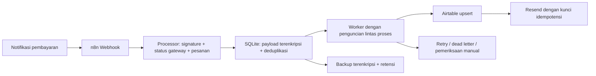

# Payment Receipt Automation v2

Proyek portofolio: **n8n → verifikasi pembayaran → antrean persisten → Airtable → email receipt**. Ini demo, bukan proyek klien aktif atau bukti uang sungguhan. Mode awal tidak menghubungi provider dan tidak mengirim email.

Demo lokal dapat dijalankan tanpa akun n8n Cloud, Airtable, Midtrans atau Resend. Setup akun di bawah hanya diperlukan bila melanjutkan ke integrasi provider asli.

## Coba sekarang

Butuh Python 3.12+:

```powershell
python -m pip install -r requirements.txt
python run_demo.py
python -m unittest -q
```

Demo mengirim dua request HTTP lokal: yang pertama `202 queued`, yang kedua `200 duplicate` setelah worker menyelesaikan pekerjaan. Tepat satu record dan satu receipt simulasi. Lihat `demo-result.json`. Data demo bersifat sementara.

**Queued berarti diterima dan tersimpan, bukan email sudah dikirim.** Status akhir diperiksa melalui `admin.py status` atau endpoint privat `/metrics`. Provider menerima email juga belum menjamin email masuk inbox.

## Apa yang dibuat



Workflow n8n memiliki 3 node operasional: Webhook → HTTP Request → Respond to Webhook. **Verifikasi, antrean, Airtable dan email dijalankan layanan Python pendamping**, yang harus tetap berjalan. Ini bukan workflow native tanpa layanan tambahan. `cryptography` dipakai untuk enkripsi Fernet yang sudah tersedia dan tidak dibuat sendiri.

| File | Fungsi |
|---|---|
| `workflow.n8n.json` | Webhook demo; Header Auth; hanya dapat diproses dalam mode demo |
| `workflow.midtrans.n8n.json` | Notifikasi Midtrans Sandbox; verifikasi signature dan GET status di processor |
| `processor.py` | HTTP, validasi, antrean, worker, retry, audit privat, retensi |
| `gateway.py` | Adapter Midtrans Sandbox, cocokkan status/nominal/pesanan |
| `storage.py` | Enkripsi, penguncian lintas proses, backup dan restore |
| `admin.py` | Perintah operator lokal; tidak ada endpoint admin publik |
| `configure.ps1`, `start-private.ps1` | Simpan rahasia dengan Windows DPAPI dan batasi akses folder |
| `publish.py` | Kemas hanya file yang diizinkan dan periksa kemungkinan kebocoran key |
| `OPERATIONS.md` | Setup akun, TLS, retry, rotasi key, backup, pemulihan |
| `SECURITY.md` | Batas keamanan dan risiko yang masih perlu dikelola |
| `TESTING.md` | Bukti tes dan bagian yang belum terverifikasi |

## Jalankan dengan n8n

1. Jalankan `configure.ps1 -Mode demo`, kemudian `start-private.ps1`. Konfigurasi masuk `.private/settings.xml`, terenkripsi untuk pengguna Windows saat ini. Jangan mengekspor atau merekam isi rahasianya.
2. Impor `workflow.n8n.json` ke instance n8n. File tidak membawa credential dan tidak otomatis aktif.
3. Pada **Payment Webhook**, pilih credential Header Auth: Name `X-Webhook-Key`, Value key acak tersendiri.
4. Pada **Process Receipt**, pilih credential Header Auth: Name `X-Processor-Key`, Value key processor. Isi dari penyimpanan privat tanpa menaruh key pada parameter node. Bila memakai `configure.ps1`, ikuti cara mengisi credential lokal di OPERATIONS.
5. URL processor: n8n langsung di PC yang sama `http://127.0.0.1:8787/payments`; compose `http://processor:8787/payments`. n8n Cloud membutuhkan processor ter-host dengan HTTPS, bukan localhost PC.
6. Klik Listen for test event dan kirim `sample-payment.json` ke Test URL. Untuk pengulangan, publish workflow dan gunakan Production URL. `demo.ps1` memakai PAYMENT_URL dan WEBHOOK_KEY dari environment privat; listener test mungkin perlu diaktifkan ulang.
7. Pastikan pertama `queued`, lalu status worker `done`, lalu request identik `duplicate`. Jangan menampilkan data eksekusi nyata di rekaman.

Pilihan Docker: isi `.env` secara privat dari `.env.example` lalu `docker compose up -d --build`. n8n editor hanya dibuka di loopback `127.0.0.1:5678`; processor tidak dipublikasikan. Konfigurasi publik HTTPS opsional ada di OPERATIONS. Docker/deploy host tidak diasumsikan telah diuji hanya karena konfigurasi tersedia.

## Kontrak data demo

Contoh lengkap: `sample-payment.json`.

| Field | Aturan |
|---|---|
| payment_id / order_id | Stabil; 1–80 huruf/angka/underscore/hyphen |
| email | Satu alamat, tanpa karakter kontrol atau baris baru, maksimal 254 karakter |
| amount | Integer rupiah >0 hingga 1 miliar; boolean/string/pecahan ditolak |
| currency / status | `IDR` / `paid` |
| paid_at | ISO 8601 dengan zona waktu; dinormalisasi ke UTC |

Field tambahan diabaikan; JSON dengan key ganda ditolak. Payload wajib yang berbeda pada payment_id sama ditolak 409. Fingerprint tetap disimpan setelah data pribadi lokal dibersihkan, sehingga pembayaran lama tetap tidak diproses ulang.

## Pembayaran terverifikasi: Midtrans Sandbox

Untuk integrasi rupiah, adapter yang disertakan memakai **Midtrans Sandbox saja**, bukan endpoint uang sungguhan. Langkah akun lengkap ada di OPERATIONS.

1. Daftarkan pesanan tepercaya secara lokal memakai `sample-order.json` dan `admin.py register-order`. Email receipt berasal dari pesanan ini, bukan dari pengirim webhook.
2. Isi MIDTRANS_SERVER_KEY sandbox, konfigurasi Airtable dan Resend secara privat. Uji email hanya ke alamat milikmu yang telah disetujui sebagai TEST_RECIPIENT.
3. Impor `workflow.midtrans.n8n.json`. Webhook publik ini tidak memakai Header Auth karena Midtrans mengirim signature sendiri; node HTTP internal **tetap** harus memakai X-Processor-Key.
4. Processor memeriksa SHA512 sesuai Midtrans, mengambil status langsung dari API sandbox, mencocokkan ID pesanan/mata uang/nominal/status lunas/fraud status, lalu menyimpan antrean.
5. Mode live menolak `/payments`; request demo tidak bisa melewati verifikasi gateway. `live` berarti API Airtable/Resend asli dengan pembayaran sandbox dan satu penerima uji, bukan aktivasi pembayaran produksi.

Midtrans signature tidak mengikat semua field dan tidak memakai format timestamp generik. Karena itu status dan email dari notification tidak dipercaya. Replay ditangani dengan identitas transaksi stabil dan ledger deduplikasi yang tidak dihapus. Untuk gateway lain diperlukan adapter dan tes sesuai dokumentasi penyedia tersebut.

## Fitur perlindungan dan pemulihan

- Payload, email, pesanan dan outbox terenkripsi; key live harus disimpan terpisah dari database.
- Insert ID pembayaran atomik; penguncian OS mencegah dua proses lokal melakukan pengiriman bersamaan.
- Worker melanjutkan pekerjaan tertunda setelah restart. Backoff eksponensial dengan jitter; setelah 8 kegagalan masuk `dead`.
- Pesan email dan kunci idempotensi tetap sama pada retry. Setelah 23 jam status kirim tidak pasti masuk `manual`, tidak dikirim ulang otomatis.
- Pembatasan request, ukuran body 16 KiB, timeout, jumlah handler terbatas, serta header respons tanpa cache.
- Tidak mencatat payload/key/email pada audit; log memakai referensi HMAC. Metrics terlindungi key internal.
- Backup terenkripsi otomatis saat layanan berjalan dan tiap hari; retensi lokal 30 hari dan backup 7 hari secara default.
- Ketika retensi selesai, email Airtable dibersihkan berdasarkan record ID. Metadata keuangan/ID tetap ada; retensi salinan provider email perlu diatur di akun provider.
- ZIP publik dibuat dari allowlist; `.env`, `.private`, database, backup dan credential tidak ikut.

Lihat SECURITY untuk batas: satu host dengan disk lokal; bukan cluster HA, bukan jaminan exactly-once lintas sistem; TLS/akun/backup off-host perlu disiapkan dan diuji.

## Publikasi portofolio

Jalankan tes dan demo, lalu `python publish.py`. ZIP disimpan di folder induk bersama manifest SHA256. Gunakan sampel fiktif, label **Portfolio demo — simulated/sandbox payment**, dan jangan mengklaim ini klien aktif. Pemindai rahasia bersifat heuristik; tetap tinjau rekaman dan file sebelum membagikan. Jangan memakai zip seluruh folder proyek.

## Rujukan resmi

- [n8n Webhook](https://docs.n8n.io/integrations/builtin/core-nodes/n8n-nodes-base.webhook/)
- [n8n HTTP Request](https://docs.n8n.io/integrations/builtin/core-nodes/n8n-nodes-base.httprequest/)
- [Airtable upsert](https://airtable.com/developers/web/api/update-multiple-records)
- [Midtrans notification dan signature](https://docs.midtrans.com/docs/https-notification-webhooks)
- [Midtrans GET status](https://docs.midtrans.com/reference/get-transaction-status)
- [Resend idempotency: 24 jam](https://resend.com/docs/dashboard/emails/idempotency-keys)
- [Fernet dan rotasi](https://cryptography.io/en/latest/fernet/)
